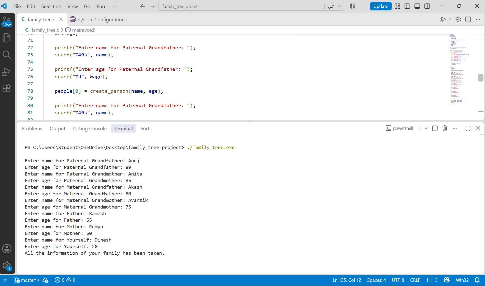
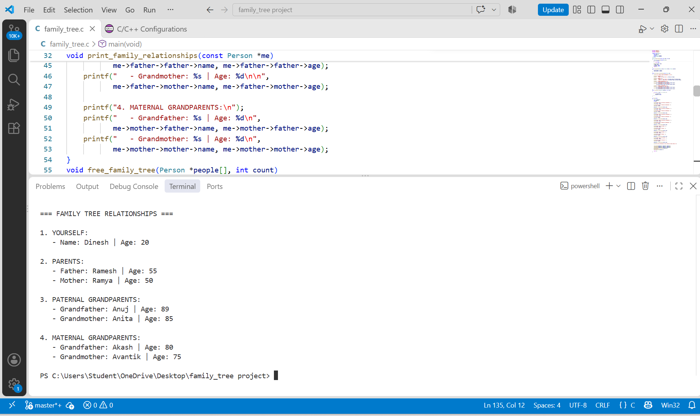

# Family Tree Project in C

#### Overview :

This project is about the using C program language creating and displaying the tree generational family tree of seven peoples. 

#### Features :

- Takes the name and age of seven family members as input.
- Uses structures and pointers to represent family relationships.
- Prints all relationship by the pointers, Using input.
-  Frees all allocated memory.

#### How to Compile and Run :

Complile the program using GCC :

gcc -Wall -Wextra -g -o family_tree family_tree.c  

Run the program :

 ./family_tree.exe

#### To check Memory leak :

Command used:

valgrind --leak-check=full --show-leak-kinds=all ./family_tree

#### Example Output :

Taking Family information as input :

The final output Looks like this :

